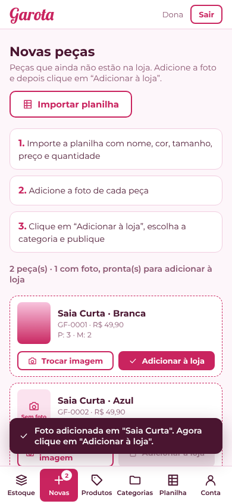
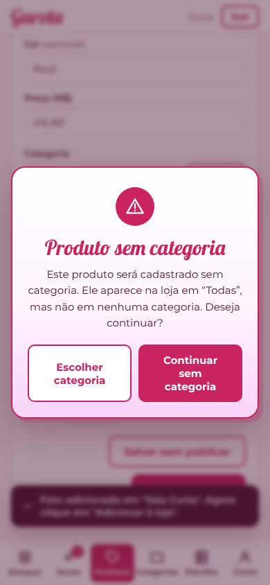
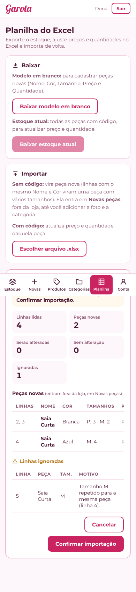
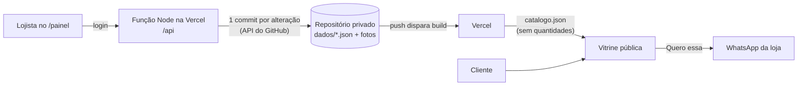

<div align="center">

# Garota Fashion

**Catálogo online de moda feminina com painel administrativo e controle de estoque, sem banco de dados.**

Vitrine pública para as clientes comprarem pelo WhatsApp e painel para a lojista cadastrar peças, controlar o estoque por tamanho e importar planilhas do Excel.

[](https://github.com/rodrigosantossilv/garota-fashion/actions/workflows/ci.yml)


</div>

---

## Sumário

- [Funcionalidades](#funcionalidades)
- [Capturas de tela](#capturas-de-tela)
- [Arquitetura](#arquitetura)
- [Tecnologias](#tecnologias)
- [Como rodar](#como-rodar)
- [Publicação na Vercel](#publicação-na-vercel)
- [Planilha do Excel](#planilha-do-excel)
- [Testes](#testes)
- [Estrutura do projeto](#estrutura-do-projeto)
- [Segurança](#segurança)

## Funcionalidades

### Vitrine (pública)
- **Abertura animada** com o nome da loja e menu de entrada.
- **Catálogo** com cabeçalho em foto, cards de categoria e filtro por categoria.
- **Card de produto** com foto, nome, cor, preço e tamanhos. Tamanho sem estoque aparece **riscado**.
- **Etiqueta ESGOTADO automática** quando todos os tamanhos zeram. A quantidade em estoque **nunca é exibida** para a cliente.
- **Botão "Quero essa"**: abre o WhatsApp da loja com peça, cor, código e tamanho já escritos.
- **Dados estruturados (JSON-LD, schema.org)** para o Google entender a loja (`ClothingStore`) e a disponibilidade de cada peça.
- **Layout responsivo**, pensado primeiro para o celular.

### Painel administrativo (`/painel`)
- **Login** com e-mail e senha. A senha é guardada com **bcrypt**, a sessão fica em **cookie httpOnly assinado**, e há proteção CSRF.
- **Estoque**: resumo (total de peças, esgotadas, estoque baixo, valor em estoque), filtros e ajuste rápido **− / +** por tamanho, salvo em lote.
- **Produtos**: cadastro, edição e exclusão. A foto é reduzida no próprio celular antes do envio.
- **Novas peças**: o que entra pela planilha fica fora da loja até ganhar foto. O botão **Adicionar à loja** só libera quando a peça tem foto.
- **Categorias**: criar, renomear, reordenar e remover, movendo as peças para outra categoria ou deixando-as sem categoria.
- **Planilha do Excel**: modelo em branco, exportação do estoque e importação com **pré-visualização** e relatório das linhas ignoradas.
- **Conta**: troca de senha (derruba as outras sessões), WhatsApp, Instagram e limite de estoque baixo.
- **Pop-ups de confirmação** nas cores da marca.

## Capturas de tela

| Vitrine no celular | Novas peças | Aviso de peça sem categoria |
|:---:|:---:|:---:|
|  |  |  |

<details>
<summary>Importação de planilha com pré-visualização</summary>
<br />

</details>

## Arquitetura

O projeto **não usa banco de dados**. Os dados ficam em arquivos JSON versionados num **repositório privado do GitHub**, e as gravações do painel viram commits.



- **Leitura e gravação:** o painel lê e grava direto no GitHub, então a lojista vê as próprias mudanças na hora. A vitrine é republicada pela Vercel em cerca de 1 minuto.
- **Sem quantidades na vitrine:** no build, `scripts/gerar-catalogo.js` gera um `catalogo.json` público só com a situação de cada peça (disponível ou esgotada, por tamanho).
- **Edições simultâneas:** cada gravação parte da versão lida (`force: false`). Se houver conflito, a operação é refeita sobre os dados novos e nada é sobrescrito.
- **API independente da Vercel:** a lógica (`lib/roteador.js`) não depende da plataforma. A mesma API roda no `npm run dev`, nos testes e na Vercel.

## Tecnologias

| Camada | Escolha |
|---|---|
| Front-end | Vue 3, Vite, Vue Router, Pinia |
| Back-end | Função Node.js da Vercel (rota única `/api/*`) |
| Dados | JSON no repositório, gravados pela API REST do GitHub |
| Autenticação | bcryptjs + cookie de sessão assinado com HMAC |
| Planilhas | ExcelJS |
| Testes | Vitest |
| Fontes | Archivo, Montserrat e Lobster (Google Fonts) |

## Como rodar

**Pré-requisitos:** Node.js 20 ou mais novo.

```bash
git clone https://github.com/rodrigosantossilv/garota-fashion.git
cd garota-fashion
npm install
cp .env.example .env
```

No `.env`, preencha o `SESSAO_SEGREDO`. Para gerar um valor aleatório:

```bash
node -e "console.log(require('crypto').randomBytes(48).toString('base64url'))"
```

Crie o primeiro administrador. O comando pede e-mail, nome e senha e grava só o hash:

```bash
npm run criar-admin
```

Suba o servidor de desenvolvimento:

```bash
npm run dev
```

- **Vitrine:** http://localhost:5173
- **Painel:** http://localhost:5173/painel

Com `ARMAZENAMENTO=local`, os dados são gravados direto nas pastas `dados/` e `public/produtos/`. Não é preciso GitHub nem internet para desenvolver.

### Scripts

| Comando | O que faz |
|---|---|
| `npm run dev` | Vitrine, painel e API em modo de desenvolvimento |
| `npm run build` | Gera o `catalogo.json` público e o build de produção |
| `npm test` | Roda os testes automatizados |
| `npm run criar-admin` | Cria um administrador ou redefine a senha dele |

## Publicação na Vercel

1. **Crie um repositório privado** para os dados da loja. Ele recebe os commits do painel.
2. **Gere um token fine-grained do GitHub** com acesso **apenas** a esse repositório e permissão **Contents: Read and write**.
3. **Importe o repositório na Vercel.** O `vercel.json` já define o build, a função única `/api` e as rotas.
4. **Configure as variáveis de ambiente.** O `.env.example` explica cada uma.

   | Variável | Descrição |
   |---|---|
   | `SESSAO_SEGREDO` | Segredo do cookie de sessão (mínimo de 32 caracteres) |
   | `ARMAZENAMENTO` | `github` |
   | `GITHUB_TOKEN` | Token do passo 2 |
   | `GITHUB_REPO` | `dono/repositorio-privado` |
   | `GITHUB_BRANCH` | Branch de produção da Vercel |
   | `ADMIN_INICIAL_EMAIL` / `ADMIN_INICIAL_SENHA` | Opcional: cria o primeiro administrador no primeiro login, sem terminal. Apague depois. |

## Planilha do Excel

Colunas: `Código | Nome | Cor | Tamanho | Preço | Quantidade`, com uma linha por tamanho.

| Situação | O que acontece |
|---|---|
| **Código em branco** | Cria uma **peça nova**. Linhas com o mesmo *Nome + Cor* viram uma peça com vários tamanhos. Ela entra como rascunho em **Novas peças**, fora da loja. |
| **Com código** (`GF-0001`) | Atualiza **preço e quantidade** daquela peça. |
| **Linha inválida** | É ignorada e aparece na prévia com o motivo, por exemplo: preço inválido, tamanho repetido ou peça já existente. |

**Na prática:**
- **Nada é salvo antes da confirmação:** o painel mostra a prévia primeiro.
- **Exportar e reimportar** o mesmo arquivo não altera nem perde nada.

## Testes

```bash
npm test
```

São 56 testes automatizados, que rodam também na CI a cada push:

- **Autenticação:** a senha nunca fica em texto puro; testes de login, rotas protegidas, cookie adulterado ou expirado, CSRF e troca de senha que invalida as sessões antigas.
- **Regra do ESGOTADO:** a vitrine nunca recebe quantidades; rascunhos e peças sem foto não aparecem na loja.
- **Planilha:** exportar e reimportar sem perda, peças novas agrupadas por nome e cor, linhas ignoradas com motivo.
- **Gravação no GitHub:** um commit por operação, nova tentativa em caso de conflito e mensagens de erro claras.

## Estrutura do projeto

```
├── api/roteador.js           Função única da Vercel (todas as rotas /api/*)
├── lib/                      Regras de negócio e API, independentes da plataforma
│   ├── armazenamento/        local (arquivos) e github (commits pela API)
│   ├── rotas/                auth.js e painel.js
│   ├── catalogo.js           catálogo público (sem quantidades)
│   ├── situacao.js           regras de ESGOTADO e estoque baixo
│   ├── planilha.js           importação e exportação .xlsx
│   └── dados-estruturados.js JSON-LD para o Google
├── src/                      Vue 3
│   ├── views/vitrine/        abertura e catálogo
│   ├── views/painel/         painel (carregado à parte: a cliente não baixa esse código)
│   └── components/
├── dados/                    "banco" em JSON (vazio neste repositório)
├── scripts/                  criar-admin e gerar-catalogo
├── tests/                    Vitest
└── docs/capturas/            imagens deste README
```

## Segurança

- **Credenciais:** nenhuma credencial fica no código. Segredos ficam só nas variáveis de ambiente (`.env` está no `.gitignore`).
- **Senhas:** são guardadas apenas como hash **bcrypt** (custo 12).
- **Sessão:** cookie `HttpOnly`, `SameSite=Strict` e `Secure` em produção, assinado com HMAC. A troca de senha invalida as sessões anteriores.
- **Escrita na API:** toda escrita exige sessão válida e um cabeçalho próprio do painel (proteção CSRF).
- **Uploads:** imagens são validadas pelo conteúdo do arquivo (JPG, PNG ou WEBP), com limite de tamanho.
- **Este repositório:** contém **apenas o código**. Os dados reais da loja (estoque, contas) ficam num repositório privado separado.

---

<div align="center">
<sub>© Garota Fashion · Feira de Santana - BA · Todos os direitos reservados.</sub>
</div>
